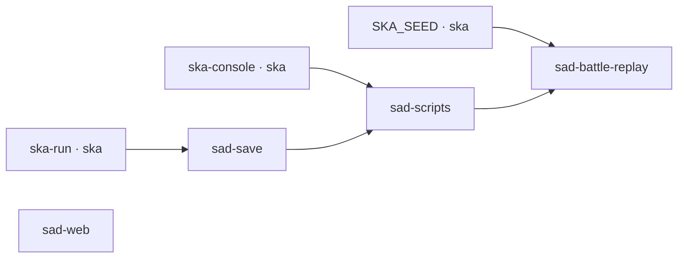
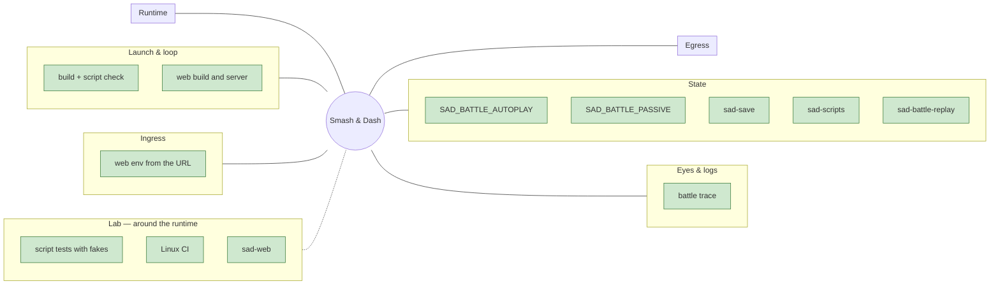

# Agent map — Smash & Dash @ 2ceb720 (2026-11-23)

## Contents
- Parallel agents
- Tools already in place
- Capabilities
- Delivered handles
- Candidate handles (not built)
- Deferred handles
- Roadmap
- Transferable patterns
- Rules → guards
- Fences to set first
- Diagram
- Points
- Classes with no point
- Unknowns
- Decisions
- Revisions
- Accepted plan
- Grill
- Noticed in passing

**Shape(s):** game (real-time, on the ska engine) + scripting content (skalang) · **Repos covered:** Smash & Dash; the engine is mapped in `external/ska/docs/agent-map.md` (its handles are **Uses:** here) · **Mapped by:** Claude (toolsmith map), not grilled yet

**Variants:**
- native: `LD_LIBRARY_PATH=build/lib build/bin/ska_main` from the repository root (`CLAUDE.md`); every engine handle (`ska-run`, `ska-console`) targets this one first.
- web (branch `feat/web`): `tools/web/build.sh`, `tools/web/serve.sh`, page `src/web/shell.html`: saves in IndexedDB, environment from the URL (`?SAD_…`, `src/web/shell.html:76`), WebGL without shaders.
- battle control: `SAD_BATTLE_AUTOPLAY` (the AI plays the player's Pokemon), `SAD_BATTLE_PASSIVE` (the wild Pokemon do nothing) — `src/src/Game/Gameplay/State/StateFight.cpp:114`, `:120`.

**In one paragraph:** the *script* side is well tooled — every script is type-checked at build time, `ctest` runs script tests headless with fakes (`setNextRandom` included), and two env flags let a battle play itself. The *running game* is out of reach: it always loads the save `save1` from the repository — a save **tracked in git** that each launch writes into — its logs land in the repository root, an error opens a modal box, and nothing can warp, start a battle or take a screenshot except a human at the keyboard. Once the engine's console exists, the game needs very little of its own: **start every run from a named save fixture in its own folder**, and a handful of **scripts that use the game's existing verbs** (teleport, battle, party, variables) to reach any state; then **replay a battle** deterministically and **drive the web build** in a headless browser.

## Parallel agents

**Agents that can safely work at once today: 1 running the game** (script tests and builds are per worktree and safe) — two runs from the same checkout write the same save and the same logs.

| Shared resource | Shared by | What collides | Isolation today | Proposal (level 1 · 2 · 3) |
|---|---|---|---|---|
| `Data/Saves/save1/` (tracked in git) | every native run from a checkout | the load truncates `tmpscripts.data` (`src/src/Game/Gameplay/Data/SavegameManager.cpp:55`); `Save.save()`, every team change (`src/src/Game/Gameplay/Data/Team.cpp:45`) rewrite it: runs overwrite each other and dirty the human's tree | none | level 2: `SAD_SAVE_DIR`, a copy of a fixture per run (`sad-save` card) |
| log files `*.log.txt` (engine and `Game.log.txt`, `src/src/Game/__internalConfig/LoggerConfig.cpp:16`) in the repository root | every run | truncated at start, interleaved | none (gitignored, `.gitignore:44`) | Uses `ska-run` (`SKA_LOG_DIR`) |
| display, audio | every run | window and sound on the human's session | none | Uses `ska-run` (Xvfb, dummy audio) |
| port 8000 (`tools/web/serve.sh`, `PORT=8000`) | web runs | the second server fails to bind | `PORT` env | level 2: `sad-web` picks a free port per run |
| browser IndexedDB (web saves) | a human browser profile | a test run plays on the human's saves | per browser profile | level 2: a fresh Playwright context per run |
| `build/`, `build-web/` | agents in one checkout | concurrent builds | per worktree | none needed |

## Tools already in place

| Tool | Category | Verb | Way | Point(s) | Usage |
|---|---|---|---|---|---|
| build + script check | launch | check | witness | B11, B4 | `cmake --build build -j8` — fails on a script error with file and line (`smash_and_dash_scripts_check`, `src/CMakeLists.txt:60`) |
| script tests with fakes | lab | steer, check, freeze | bring out | B4, B8 | `cd build && ctest` — `tests/*_test.miniska` with `tests/fakes` (`src/CMakeLists.txt:66`); `setNextRandom` freezes the draws |
| `SAD_BATTLE_AUTOPLAY` | state | steer | reach in | B13, B3 | `SAD_BATTLE_AUTOPLAY=1 LD_LIBRARY_PATH=build/lib build/bin/ska_main` — both sides played by `Data/Battle/ai.miniska` |
| `SAD_BATTLE_PASSIVE` | state | freeze | reach in | B13 | `SAD_BATTLE_PASSIVE=1 …` — the wild Pokemon stand still (`src/src/Game/Gameplay/State/StateFight.cpp:120`) |
| battle trace | eyes | see | witness | B12 | `grep "Battle t=" Game.log.txt` (`src/src/Game/Gameplay/Fight/System/BattleSystem.cpp:89`, `:143`) |
| web build and server | launch | — | — | B11 | `tools/web/build.sh build-web && tools/web/serve.sh` |
| web env from the URL | state | steer | reach in | B13 | `http://localhost:8000/?SAD_BATTLE_PASSIVE=1` (`src/web/shell.html:76`) |
| Linux CI | lab | check | bring out | B11 | `.github/workflows/linux.yml` (Debug, Release, ctest) |
| asset scripts | launch | — | — | B11 | `python3 tools/assets/tree_tops.py …` (`tools/assets/`) — content tools, not access to the game |

## Capabilities

| # | Capability — the agent can… | Today | Evidence |
|---|---|---|---|
| C1 | run the game from a chosen save, in its own folder, without touching the tracked saves | every launch loads and writes `save1` in the repository | `src/src/Game/Gameplay/World/WorldState.cpp:323` `loadGame("save1")`; `src/src/Game/Gameplay/Data/SavegameManager.cpp:55`; `git ls-files Data/Saves` lists `save1/*` |
| C2 | reach any game state — a map and position, a battle, a team, story variables — and read it back | a human walks there with the keyboard | the verbs exist for scripts (`src/scripts/game.map.miniska:5` `teleport`, `src/scripts/game.battle.miniska:10` `start`, `game.party`), but only map events and tiles start scripts |
| C3 | replay a battle exactly and read what happened | `SAD_BATTLE_AUTOPLAY` plays it, but every run differs | game generators seeded from `random_device` (`src/src/Game/Gameplay/Control/GridMovementSystem.h:91`, and `NumberUtils::random` in 5 more files: `grep -rln "random_device\|NumberUtils::random" src/src`) |
| C4 | see the web build: open it headless, set its environment, screenshot it, read its console | a human opens `http://<address>:8000` on a device | `tools/web/serve.sh`, `src/web/shell.html` |

## Delivered handles

### `sad-save` — state (+ launch) · B5 State stores · steer, freeze · reach in · cost S
**Status:** delivered
**Finishes:** the save fixtures already in the repository (`Data/Saves/new_game`, `Data/Saves/save1`)

```sh
$ tools/sad-run up a1 --save save1
{"run": "a1", "pid": 1142201, "display": ":2", "console": "/tmp/ska-runs-1000/a1/console.sock", "state": "WorldState > StateMap, StateGUIMap", "ready_ms": 270, "env": {"SAD_SAVE_DIR": "/tmp/ska-runs-1000/a1/Saves", "SAD_SAVE": "save1", …}}
$ tools/sad-run down a1 && git status --short Data/Saves
{"run": "a1", "exit": 0, "stopped_by": "console quit"}
$
```

**Is:** `src/src/Game/Gameplay/Data/SavePaths.h` — `SaveDirectory()` (`SAD_SAVE_DIR`, default `./Data/Saves/`) and `DefaultSaveName()` (`SAD_SAVE`, default `save1`), used by the 10 places that built `"./Data/Saves/" + …` (`SavegameManager.cpp`, `Team.cpp`, `Bag.cpp`, `WorldState.cpp`); `tools/sad-run`, a wrapper of the engine's `ska-run`: `--save NAME` copies `Data/Saves/NAME` into the run folder and sets both variables, `--build DIR`, `--ready eval`, `LD_LIBRARY_PATH`. Also: an uncaught error now exits 1 (`WGameCore::onException`).
**Gives the agent:** any run starts from a known save and leaves the tracked saves untouched.
**Not a script because:** the save is loaded at start, before the console runs anything.
**Origin:** map
**Uses:** `ska-run` (`--copy`, `--env` with `{run}`), from `external/ska/docs/agent-map.md`.
**Fence:** under `sad-run` the saves are always the run's copy.
**Parallel:** one copy per run (two runs side by side in the replay demo).
**Permission:** allow.
**Verified:** demoed — 2026-11-23: `tools/doctor` compares the md5 of every file of `Data/Saves` before and after a run that warps, battles and saves: unchanged.

### `sad-scripts` — state (+ ingress) · B3 Runtime · steer, see · reach in · cost S
**Status:** delivered
**Finishes:** the game's script verbs (`src/scripts/game.*.miniska`)

```sh
$ external/ska/tools/ska-console run tools/agent/warp.miniska w_room_0 11 8
{"ok": true, "value": "w_room_0 (11,8)", "frames": 30}
$ external/ska/tools/ska-console run tools/agent/party.miniska
{"ok": true, "value": "2 pokemon\n#0 Bulbizarre lv4 hp 34\n#1 Pikachu lv4 hp 32", "frames": 0}
$ external/ska/tools/ska-console --timeout 280 run tools/agent/battle.miniska 25 3      # run started with --env SAD_BATTLE_AUTOPLAY=1
{"ok": true, "value": "won=false fled=false hp=0", "frames": 4135}
$ external/ska/tools/ska-console --raw eval 'Map.name()'
w_1_1
```

**Is:** `tools/agent/*.miniska` (`warp`, `battle`, `party`, `variables`, was `story-step`), checked by the build with the game scripts (`AGENT_SCRIPTS` in `src/CMakeLists.txt`, with the engine's); the console prelude of the game (`GameDialog`, `Character`, `Map`, `Party`, `Interface`, `Battle`, `Save`, `Bag`: `WorldState.cpp`); new verbs `Map.name()`, `Map.waitTransition()` (waits for the end of the fade of a map change — no polling), `Party.species(index)`, `Engine.variables()` (`SavegameManager::getGameVariables`). Under `SAD_BATTLE_AUTOPLAY` the battle messages close by themselves after 1.5 s (`DialogTransition`: nobody plays), so a battle runs unattended.
**Gives the agent:** any map, position, battle, team or story step in one command, with the game's own rules.
**Not a script because:** it is the scripts (one card for the folder).
**Origin:** map
**Uses:** `ska-console` (from `external/ska/docs/agent-map.md`).
**Fence:** through the console only; saves only into the run's copy.
**Parallel:** per run.
**Permission:** allow.

| Script | Usage → prints | Needs |
|---|---|---|
| `warp` | `run tools/agent/warp.miniska w_room_0 11 8` → `w_room_0 (11,8)` | delivered: `Map.name()`, `Map.waitTransition()` |
| `battle` | `run tools/agent/battle.miniska 25 3` → `won=false fled=false hp=0` | delivered: the messages close under autoplay |
| `party` | `run tools/agent/party.miniska` → `2 pokemon · #0 Bulbizarre lv4 hp 34 · …` | delivered: `Party.species(index)` |
| `var` | `eval 'Engine.variable("%00012")'` → `{"value":"0"}` | none |
| `variables` (was `story-step`) | `run tools/agent/variables.miniska [prefix] [all]` → the variables not 0, `name=value` | delivered: `Engine.variables()` |
| `wild` | `run tools/agent/wild.miniska` → `monster level x y attitude` per wild Pokemon | delivered: `Battle.wild()` |
| `walls` | `run tools/agent/walls.miniska 52 54` → a row per block row, `.` free, `#` a wall (the physics) | none: `Map.blockFree` |
| tile room | `tools/worldgen/tileroom.py <save>/World` → the map `w_tiles` (every tile of the generator, its exhibits and where to stand) ; `--walls walls.json --at X Y` → the walls of the game against the generator's | `tools/doctor` (2026-11-26) |

**Verified:** demoed — 2026-11-23 (each row ran; a battle of 82 s unattended; `tools/doctor`).

### `sad-battle-replay` — state · B8 Time & chance · freeze, check · reach in · cost S
**Status:** delivered
**Finishes:** `SAD_BATTLE_AUTOPLAY` and the `Battle t=` trace

```sh
$ tools/sad-run up r1 --seed 7 --fixed-step --pause-at 120 --env SAD_BATTLE_AUTOPLAY=1   # and r2, the same
$ ska-console --run r1 --timeout 280 run tools/agent/battle.miniska 25 3 &  ska-console --run r1 resume   # and r2
{"ok": true, "value": "won=false fled=false hp=0", "frames": 4736}
$ external/ska/tools/ska-run logs r1 --grep "Battle t=" --strip --tail 0 > r1.trace   # r2.trace the same : diff → exit 0
```

**Is:** `GridMovementSystem`'s generator seeded from the engine (`NumberUtils::newSeed`), the other draws already through `NumberUtils::random`; the replay is the engine's `--seed`, `--fixed-step`, `--pause-at` plus `ska-run logs --strip`.
**Gives the agent:** a battle replayed exactly; its trace diffed against a fix.
**Not a script because:** the seed must hold from the first draw.
**Origin:** map
**Uses:** `SKA_SEED`, the clock (from `external/ska/docs/agent-map.md`).
**Fence:** none needed.
**Parallel:** per run (the demo ran its two runs at once).
**Permission:** allow.
**Verified:** demoed — 2026-11-23: seed 7 twice → the same result, 4736 steps both, traces of 968 lines identical (`diff` exit 0); seed 8 → another battle (4565 steps), traces differ.

### `sad-web` — lab (+ eyes) · B10 Platform · steer, see · bring out · cost M
**Status:** delivered
**Finishes:** `tools/web/serve.sh` and the URL environment of `src/web/shell.html:76`

```sh
$ tools/web/sad-web up w1 --env SAD_BATTLE_PASSIVE=1
{"run":"w1","url":"http://127.0.0.1:33995/?SAD_BATTLE_PASSIVE=1","frames":72,"ready_ms":2653,"folder":"/tmp/sad-web-1000/w1"}
$ tools/web/sad-web shot w1 start
{"ok":true,"path":"/tmp/sad-web-1000/w1/shots/start.png","frames":178}
$ tools/web/sad-web press w1 KeyD 600
{"ok":true,"pressed":"KeyD"}
$ tools/web/sad-web console w1 --grep -i error
(no lines)
$ tools/web/sad-web down w1
{"run":"w1","stopped":true}
```

**Is:** `tools/web/sad-web` (Node, Playwright 1.62.1 in `tools/web/package.json`, `npm install --prefix tools/web`; `node_modules` ignored): `up` starts a daemon per run that serves `build-web/game/bin` on 127.0.0.1 (a free port), opens headless Chromium (SwiftShader WebGL) in a fresh context (its own IndexedDB saves), the `SAD_…` environment in the URL, and takes `shot` (the canvas), `press`, `eval`, `down` through a Unix socket; the page's console in `console.log`. Ready when the engine has drawn N frames: `Module.skaFrames`, counted by `GameCore::run` on the web (engine).
**Gives the agent:** the web build seen, driven and checked without a phone or the human's browser.
**Not a script because:** it runs in the browser.
**Origin:** map
**Fence:** binds 127.0.0.1 only; a fresh browser context per run; only `SAD_…` variables in the URL.
**Parallel:** a port, a browser and a folder per run.
**Permission:** allow; `tools/web/serve.sh` (all interfaces) denied for agents.
**Verified:** demoed — 2026-11-23: up (72 frames, 2.7 s), the shot of greencity, `KeyD` moved the hero from block 14 to 16, no console error, down; in `tools/doctor` (skipped there when `build-web` or Playwright is absent : the CI job has neither — the web is checked locally).

## Candidate handles (not built)

(none : the four proposed cards are delivered)

## Deferred handles

### `sad-input-replay` — ingress · B1 Human UI · steer, freeze · reach in · cost M
**Status:** deferred
**Deferred because:** the engine's `press` (input injection) and `clock` must exist first; recording is a second step.
**Revisit when:** ska M2 and M3 are delivered and a bug needs a human's exact key sequence.

```sh
$ ska-console --run a1 eval 'Dev.replay("bugs/fall-through-ledge.keys")'
{"ok":true,"frames":612}
```

## Roadmap

**Foundations** — from the engine map (`external/ska/docs/agent-map.md`): `ska-run`, `ska-console`. The game's own:

| Foundation | Used by | Unlocks | Cost |
|---|---|---|---|
| `sad-save` (one save root) | every run, `sad-scripts`, `sad-battle-replay` | parallel runs, no write in the tracked saves | S |



### M1 — the game in its own run, from a save · keystone
**Capability:** C1 — run the game from a chosen save, in its own folder.
**Status:** delivered
**Builds:** `sad-save`.
**Depends on:** ska M1 — `ska-run`, `ska-console` (the game's demo is the engine's M1 demo, run on Smash & Dash).
**Demo:** `external/ska/tools/ska-run up a1 --save save1 -- build/bin/ska_main && ska-console --run a1 run external/ska/tools/agent/shot.miniska start && external/ska/tools/ska-run down a1 && git status --short Data/Saves`
**Expect:** the shot shows the player on the start map of `save1`; `git status --short Data/Saves` prints nothing.
**Verified:** demoed — 2026-11-23 (`tools/sad-run up a1 --save save1`, the shot of greencity, `Data/Saves` unchanged: md5 in `tools/doctor`).

### M2 — reach any state
**Capability:** C2 — reach any game state and read it back.
**Status:** delivered
**Builds:** `sad-scripts` (`warp`, `battle`, `party`, `var`, `story-step`).
**Depends on:** M1 — runs start from a fixture; ska M1 — the console.
**Demo:** `ska-console --run a1 run tools/agent/warp.miniska Town 12 8 && ska-console --run a1 run external/ska/tools/agent/shot.miniska town && ska-console --run a1 run tools/agent/battle.miniska 25 5` (the run started with `--env SAD_BATTLE_AUTOPLAY=1`)
**Expect:** `town.png` shows the player at Town (12,8); `battle` returns `won=…` after the battle ended with no key pressed.
**Verified:** demoed — 2026-11-23 with the real map names (`spore_ville`, no "Town"): the shot shows the player at (12,8) after the fade; `battle 25 3` answered `won=false fled=false hp=0` after 82 s, no key pressed.

### M3 — replay a battle
**Capability:** C3 — replay a battle exactly and read what happened.
**Status:** delivered
**Builds:** `sad-battle-replay`.
**Depends on:** M2 — the `battle` script; ska M3 — `SKA_SEED`, `clock`.
**Demo:** two runs `--seed 7 --env SAD_BATTLE_AUTOPLAY=1`, `battle 25 5` in each, `diff` of their `Battle t=` traces.
**Expect:** `diff` prints nothing and exits 0; with `--seed 8` the traces differ.
**Verified:** demoed — 2026-11-23 (with `--fixed-step --pause-at 120`: the battle must start at the same step).

### M4 — see the web build
**Capability:** C4 — see the web build.
**Status:** delivered
**Builds:** `sad-web`.
**Depends on:** none (independent track).
**Demo:** `tools/web/build.sh && tools/web/run.sh up w1 --env SAD_BATTLE_PASSIVE=1 && tools/web/run.sh shot w1 start && tools/web/run.sh console w1 --grep Error; tools/web/run.sh down w1`
**Expect:** `start.png` shows the map with the player; the console grep prints no line.
**Verified:** demoed — 2026-11-23.

### Deferred
- `sad-input-replay` — after the engine's `press` and `clock`.

## Transferable patterns

| Pattern | Does | Evidence here | Fits when | Does not fit when | Here as |
|---|---|---|---|---|---|
| script tests against fakes of the native modules | test content scripts headless by swapping the native bindings for script fakes with a test-control API (`setNextRandom`) | `tests/fakes/ska.engine.miniska`, `src/CMakeLists.txt:66` | natives are declared by templates (an interface file per module) | content logic lives in native code | in place (`ctest`) |
| environment from the URL for a web build | the same debug switches on native (env) and in the browser (query string → `Module.ENV`) | `src/web/shell.html:76` | the native build already reads env flags | the page is published to players (strip it there) | `sad-web --env` |

## Rules → guards

| Rule (where) | Guard | Kind |
|---|---|---|
| "Add a test with a script change when the script has logic" (`CLAUDE.md`, Build and run) | CI check: a change to `Data/Battle/*.miniska`, `Levels/dialog.miniska` without a change in `tests/` warns | CI |
| "A script only imported by other scripts (no `run` function) is listed in `GAME_SCRIPT_MODULES`" (`CLAUDE.md`, Scripts) | already enforced by `smash_and_dash_scripts_check` (a module without `run` fails) — confirm, else a check in the build | lint |
| "The texts are UTF-8" (`CLAUDE.md`, Scripts) | pre-tool hook / build check: reject the files that are not valid UTF-8 in `Levels/**/*.miniska`, `Data/**/*.ini` | hook |
| "Change the template with the C++ binding" (`CLAUDE.md`, Scripts) | a build check that each `bindField("x")` of `src/src/Game/Script/GameScriptModule.cpp` has `x = function` in `src/scripts/game.<module>.miniska` | lint |
| "A missing feature for scripts is a new verb in a game module …, not polling from the script" (`CLAUDE.md`, Boundaries) | review only (no mechanical test) | — |
| run the game "from the repository root" (`CLAUDE.md`, Build and run) | `ska-run --cwd` sets it; a hook pointing a bare `build/bin/ska_main` launch to `ska-run` | hook |

## Fences to set first

| ⚠ | Fence | Evidence | Why it matters to an agent |
|---|---|---|---|
| 1 | every launch writes into the tracked save `Data/Saves/save1` | `src/src/Game/Gameplay/Data/SavegameManager.cpp:55` truncates `tmpscripts.data`; `src/src/Game/Gameplay/Data/Team.cpp:45`; `git ls-files Data/Saves` | an agent's run dirties the human's tree and loses their save state; `sad-save` before any agent launch |
| 2 | an uncaught error opens a modal box | `src/src/Game/Gameplay/WGameCore.cpp:126` → `ska::MessagePopup` | an unattended run hangs; the engine's `SKA_HEADLESS` (ska map, Fences ⚠ 2) |
| 3 | the web server listens on every interface | `tools/web/serve.sh` `--bind 0.0.0.0` | an agent's web run publishes the build to the whole network; `sad-web` binds loopback |

## Diagram



(Runtime is empty in this repository on purpose: the console is the engine's — `ska-console` in `external/ska/docs/agent-map.md`.)

## Points

- **B1 Human UI** — window sized from `gamesettings.ini` (`src/src/Game/Gameplay/WGameCore.cpp:91`, 35×20 blocks of 32 px) · input contexts map/GUI (`WGameCore.cpp:82`) · see ✗ · steer human → engine `shot`, `press`
- **B1 Human UI** — modal error · `src/src/Game/Gameplay/WGameCore.cpp:111`, `:126` · blocks (Fences ⚠ 2)
- **B2 Process** — `ska_main` + `libGame` (`src/src/Game/GameLibraryEntry.cpp`), CWD = repository root (data and `wd:` scripts relative) · env `SAD_BATTLE_AUTOPLAY`, `SAD_BATTLE_PASSIVE` · → engine `ska-run`
- **B3 Runtime** — the game's `ScriptVM` and its modules · `src/src/Game/Gameplay/World/WorldState.cpp:86`; game modules `src/src/Game/Script/GameScriptModule.h:32`–`:74` (dialog, character, map, party, interface, battle, save, inventory) · events `battle.won/lost/fled` (`WorldState.cpp:92`) · steer ✗ from outside → `sad-scripts` over `ska-console`
- **B4 Internal seams** — templates `src/scripts/game.*.miniska` ↔ `GameScriptModule.cpp` · check ✓ build · lab ✓ `tests/fakes`
- **B4 Internal seams** — battle rules and AI as scripts · `Data/Battle/rules.miniska`, `Data/Battle/ai.miniska`, called through `BattleRules` · lab ✓ `tests/battle_rules_test.miniska`, `tests/battle_ai_test.miniska`
- **B5 State stores** — saves · `Data/Saves/<save>/` (`trainer.ini`, `variables.ini`, `Team/<i>.ini`, `tmpscripts.data`) · save name hard-coded `save1` (`src/src/Game/Gameplay/World/WorldState.cpp:73`, `:323`) · tracked in git · steer ~ edit files by hand · loop ✗ shared, written at load
- **B5 State stores** — web saves · IndexedDB mounted on `Data/Saves` (`src/web/shell.html:81`) · per browser profile
- **B5 State stores** — settings · `gamesettings.ini` (read at start, `WGameCore.cpp:90`)
- **B8 Time & chance** — battle time on the engine clock (`BattleStage`), hit stops · freeze ✗ → engine `clock`
- **B8 Time & chance** — game RNG · `src/src/Game/Gameplay/Control/GridMovementSystem.h:91` (`random_device`), `NumberUtils::random` in `Weather.cpp`, `CustomEntityManager.cpp`, `Fight/BattleEffects.cpp`, `Fight/System/BattleSystem.cpp`, `Fight/System/FightStartSystem.cpp` · freeze ✗ (✓ in script tests: `setNextRandom`)
- **B10 Platform** — shaders need the `gpu` renderer (`Shaders/*.frag.spv`), WebGL on the web without them · audio `Sounds/`, `Music/`
- **B11 Delivery** — `src/CMakeLists.txt` (game library, script check, script tests, web packing of the data folders into `index.data`), `tools/web/build.sh`, CI `.github/workflows/linux.yml`, engine as submodule `external/ska`
- **B12 Telemetry** — `Game.log.txt` (`src/src/Game/__internalConfig/LoggerConfig.cpp:16`) + engine logs in the repository root; battle trace `Battle t=` (`src/src/Game/Gameplay/Fight/System/BattleSystem.cpp:89`) · see ✓ · loop ✗ shared
- **B13 Configuration** — `SAD_BATTLE_AUTOPLAY`, `SAD_BATTLE_PASSIVE` (env; URL on the web); `gamesettings.ini` (`fog_active`, `weather_active`, `particles_active`, `sound_volume`)

## Classes with no point
- B6 Egress — none found (looked at: sockets, HTTP, `curl` in `src/src`; the web page loads only its own files). On the web, `tools/web/serve.sh` is ingress for devices, not egress of the game.
- B7 Ingress — none besides input devices and env / URL parameters (→ B13).
- B9 Identity — none found (single local player; the "identity" is the save → B5).

## Unknowns
- Is `Data/Saves/save1` meant to be tracked (a shared dev save) or committed by accident? Decides whether `sad-save` fixtures live next to it or replace it. → grill 1.

## Decisions

- 2026-11-23 — Grill answered as recommended: `save1` is a dev fixture on purpose (runs use a copy); the web track goes now. (review: "I agree with all the points")
- 2026-11-23 — Remote eval in skalang is the priority (the human, during the build).

## Revisions

- 2026-11-23 — Built. `sad-save`'s option lives in a game wrapper, `tools/sad-run` (it calls the engine's `ska-run` with `--copy` and `--env`), not in `ska-run` itself. `warp` waits with a new verb, `Map.waitTransition()`, instead of polling the map name (the project's rule: a verb, not polling). Under `SAD_BATTLE_AUTOPLAY` the battle messages close by themselves: scripts are frozen during a battle (the `ScriptVM` is updated by the map state), so no script could close them, and autoplay means nobody plays. The replay needs `--pause-at` (engine). `sad-web` is `tools/web/sad-web` (Node + Playwright, a daemon per run) instead of `tools/web/run.sh`, and the engine counts the web frames (`Module.skaFrames`) for its readiness.

## Accepted plan

2026-11-23 — "Please implement the tools" (all milestones M1–M4), remote eval first (engine): `sad-save` → `sad-scripts` → `sad-battle-replay`; `sad-web` independent. Delivered: see above.

## Grill

1. **Is `Data/Saves/save1` a dev fixture on purpose?** Recommended: yes, keep it as the default fixture, add `Data/Saves/fixtures/<name>` for named states, and never let a run write into either (runs work on a copy).
2. **Should the web track (`sad-web`, M4) wait for the native console, or go now?** Recommended: now — it needs nothing from the engine, and `feat/web` is the active branch.

## Noticed in passing

`tools/web/serve.sh` serves the build on `0.0.0.0` by design (to test on phones) — fine for the human, not for an agent's runs (Fences ⚠ 3).
